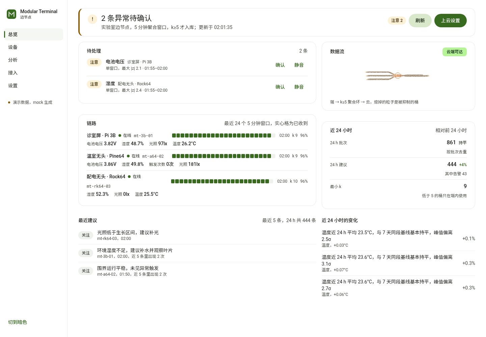
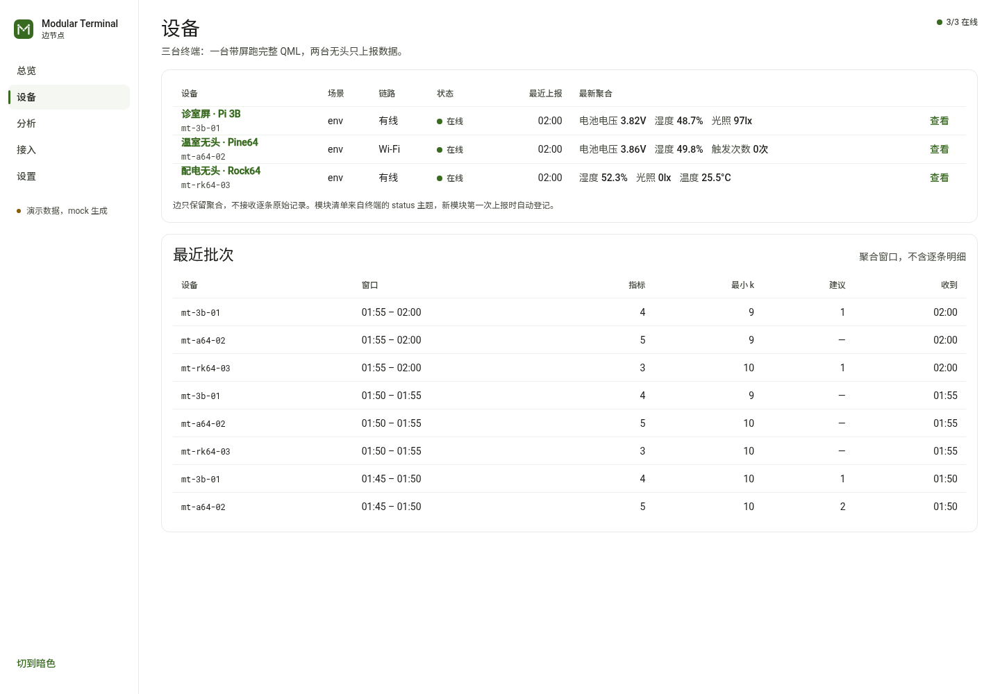

# Modular Terminal Edge

端-边-云三层里的**边**：局域网内的一台管理节点。三台 Pi 终端把 5 分钟窗口的
**假名聚合**推上来，这里做趋势、时段矩阵、词云和异常检测，再把日聚合打包上报云端。



## 与终端仓对齐

指标名、模块号、数据表都取自终端仓的真实实现，不是另起一套：

| 终端里的东西 | 边这里怎么用 |
|---|---|
| `module_id 83` `health.pressure` | 收缩压 / 舒张压 / 脉搏（`measurements` 表） |
| `module_id 80` `planter.environment` | 温度 / 湿度（`samples` 表） |
| `module_id 129` `test.environment` | 温度 / 湿度 / 光照（无头机 A） |
| `module_id 130` `test.counter` | 计数增量 / 计数速率（无头机 B，`readings` 表） |
| 字段白名单 `temperature_c` `humidity_rh` `light_lux` `battery_v` `battery_pct` | 直接作为指标 key |
| `Measurements.systolic/diastolic/pulse` | 直接作为指标 key |

三机布局与方案一致：1 台带屏 + 2 台无头。

**模块不是写死的。** 端在 `telemetry` 里带上 `module_id / label / unit / table / decimals`，
边把它登记进 `catalog` 表（键是 `(device, metric)`）；`status` 主题还可以直接推模块清单。
换一块板子、插一个新模块、同一台机器换模块，边都不用改代码：

- 新指标第一次出现就出现在 `/api/v1/metrics` 与所有下拉框里
- 设备的模块列表来自 `status`，不再有 `DEVICES` 常量
- 演示数据每次 `./run.sh` 都会重抽板子与模块组合（`edge/sim.py` 的 `fleet()`）

`catalog` 表就是「这台设备有哪些指标」的唯一事实来源，分析层、热力图、
上云报表全部从它取标签和单位。



## 每个页面回答一个问题

前端是 Vue 3 + Vite + ECharts，样式用自写的 Material 3 token（颜色角色、字阶、形状、
状态层、密度都按 m3.material.io 的定义，不引组件库）。亮色默认，右上可切暗色；ECharts 图表、数据流与拓扑都会跟着换主题；
紧凑密度（行高 40px）为了在一屏里多看 30% 的数据。

| 页面 | 它回答的问题 | 关键内容 |
|---|---|---|
| 总览 | 现在有没有事，先处理哪一条？ | 状态行（严重度 + 计数）、待处理异常 Top 4（确认/静音）、链路到达条、近 24 小时对比、数据流缩略图 |
| 设备 | 哪台设备在偏离基线？ | 设备表、模块清单、最近批次；点进去是趋势（ECharts）+ 指标 + 批次 |
| 分析 | 什么时段在出事？ | 7×24 时段矩阵（ECharts 热力）、词云、\|z\| ≥ 2.5 的异常窗口 |
| 接入 | 谁连上来了，证书还有多久？ | mDNS 发现、链路类型、配对码、证书剩余天数、CA/CRL 下载 |
| 设置 | 上报与环境怎么配？ | 上报节奏、保留期、云连接与发件箱、隐私计数、报表预览（上云已并入本页） |

## 快速开始

```bash
python3 -m pip install -r requirements.txt
./run.sh                       # 首次自动写入 7 天演示数据
# http://127.0.0.1:8001
```

前端（Vue 3 + Vite + ECharts，手写 Material 3 token）：

```bash
cd web && npm install && npm run dev     # http://127.0.0.1:5173，/api 代理到 8001
npm run build                            # 产物 dist/ 不进仓库，镜像里多阶段构建
```

Docker（含 mTLS broker）：

```bash
python3 scripts/make_broker_cert.py mqtt.edge.local   # 用边 CA 签 broker 证书
cd docker && docker compose up -d --build
```

配置见 [`.env.example`](.env.example)。

## 数据流

```
终端 10 个隔离用户库
      │  每个 5 min 窗口：n / mean / slope / z / k
      │  k < 5 的桶在端内丢弃，只上报「抑制了几个」
      ▼
MQTT over TLS1.3 + mTLS        orpi/v1/{deviceId}/telemetry     ← 主通道
HTTPS  POST /ingest/telemetry                                   ← 兜底通道
      │  两条路都进 ingest.process：同一份校验、同一份幂等
      ├─ telemetry   原样存档（只用于审计）
      ├─ aggregates  5 min 聚合，前端与报表都从这张表重算
      └─ advice      建议文本 → jieba 分词 → 词频
      ▼
每小时打包 orpi.edge.report.v1 → 云端
      失败进发件箱，按 1 min / 5 min / 30 min / 2 h 退避，最多 7 天
```

幂等键 `sha256(device_id + window.from + window.to)[:16]`，重复投递只回 `duplicate`。

## 已实现的功能

| 能力 | 说明 | 验证方式 |
|---|---|---|
| MQTT + mTLS 接入 | QoS1、`telemetry/advice/status/ack/cmd` 五个主题、retained status、ACK 回执；status 里的版本/模块/队列深度都会落库 | `tests/test_mqtt.py` 跑假 broker；compose 里真 mosquitto 做过 mTLS 握手（TLSv1.3，身份 edge-lab-01） |
| 边 CA / 设备证书 | CN=deviceId、OU=mt-device、365 天、ECDSA P-256 | `tests/test_security.py` |
| 配对码 | 6 位 / 10 分钟 / 一次性 / 绑定公钥指纹 / 5 次失败锁 10 分钟 | 同上 |
| 吊销与 CRL | 吊销后 `verify()` 失败，CRL 可下载 | 同上 |
| mDNS | 广播 `_orpi-edge._tcp`、发现 `_orpi-device._tcp` 与 `_orpi-cloud._tcp`；静态地址（环境变量或 `cloud.json`）兜底 | `edge/mdns.py`；容器内实测发现到 `https://172.20.0.5:8443`，组播不可用时退化 |
| 定时上云 | 每小时生成报表 + 到期队列投递 | `tests/test_scheduler.py` |
| 退避与保留期 | 1/5/30 分钟、2 小时；L2 聚合保留 180 天、L3 文本 365 天 | 同上 |
| 隐私闸门 | k<5 抑制、原始字段整份 422、min/max/subject 不出端 | `tests/test_contracts.py` |
| 证书校验 | 出站前用同一份契约再验一次 | `cloudpush.send` |
| 指标目录 | 端报什么就登记什么，前端下拉框动态生成 | `edge/catalog.py` + `/api/v1/metrics` |
| 磁盘加密 | 设 `EDGE_DB_KEY` 时强制走 SQLCipher，没驱动就拒绝启动 | `store._driver` |
| 每日快照 | 每天一份 SQLite 快照，保留最近 7 份；设了 `EDGE_DB_KEY` 时交给运维脚本 | `store.snapshot` + `tests/test_scheduler.py` |
| 演示模式 | 演示环境显式开启群体分析并写审计（时间/操作者/构建号）；前端挂「演示模式」横幅 | `edge/sim.py`、`/api/v1/health` 的 `demo` |
| 词频 TF-IDF | jieba 分词 + 停用词，按天重算，查询时用 TF-IDF 加权（跨天高频词降权） | `/api/v1/wordcloud`，页面点词下钻到建议原文 |
| WiFi 配置生成 | 管理员给无头终端生成 `wpa_supplicant.conf`；口令只在请求里出现，不落库、审计只记长度 | `POST /api/v1/devices/{id}/wifi-config` |

## 隐私边界

| 允许进边 | 一律拒收 |
|---|---|
| `mean`、`slope`、`z`、`n_subjects`、`n_samples`、`k` | `user_id`、`user_name`、`subject` |
| 建议文本（不含姓名与地名） | `values`、`samples`、`raw_samples`、`records` |
| 抑制计数 | `privacy.raw = true` |

拒收是整份 422，不做"过滤后放行"；计数在 `/api/v1/privacy` 与设置页自检里可查。

## API

完整定义见 [`contracts/openapi/edge.yaml`](contracts/openapi/edge.yaml)，运行时 Swagger 在 `/api/docs`。

新增的接入相关端点：

| 方法 | 路径 | 用途 |
|---|---|---|
| POST | `/api/v1/pair/redeem` | 终端拿配对码 + CSR 换 365 天证书 |
| GET | `/api/v1/metrics` | 端上报过的全部指标（动态，无写死列表） |
| GET | `/api/v1/ca.crt` | 下发给终端的 CA |
| GET | `/api/v1/crl.pem` | 吊销列表 |
| GET | `/api/v1/certs` | 已签发证书 |
| POST | `/api/v1/devices/{id}/revoke` | 吊销某台设备的全部证书 |
| POST | `/api/v1/devices/{id}/renew` | 设备带 CSR 换新证书（旧证书到期自然失效） |
| POST | `/api/v1/devices/{id}/wifi-config` | 给无头终端生成 `wpa_supplicant.conf` |
| POST | `/api/v1/certs/verify` | 校验一张证书 |

## 契约

| 契约 | 位置 | 谁拥有 |
|---|---|---|
| `orpi.telemetry.v1`（端→边） | `contracts/wire/telemetry.v1.json` | 端仓，本仓 vendor |
| `orpi.edge.report.v1`（边→云） | `contracts/wire/edge-report.v1.json` | **本仓** |

`python3 scripts/sync_contracts.py --check` 校验 vendor 副本没漂移。

## 测试

```bash
python3 -m unittest discover -s tests -t . -v
```

**34 个用例**：契约与示例、摄取边界（原始字段 / k<5 / 幂等）、分析口径
（热力图不重复、报表样本数等于日聚合之和）、CA 与配对与 CRL、
MQTT 真实报文往返、退避序列与保留期清理、每日快照、SQLCipher 加密与错误口令拒绝、异常需连续窗口。

## 与架构文档 v2.2 的逐条对照

| 文档条目 | 要求 | 现状 |
|---|---|---|
| §5.1 部署形态 | Compose 四服务、每日快照 | ✅ 四个服务齐全；每日快照保留 7 份（`data/snapshots/`），路径可用 `EDGE_DATA_DIR` 指到 `/srv/...` |
| §5.2 接入与主题 | 5 个主题、QoS1、retained status、幂等 | ✅ 全部实现，ACK 回执带 batch_id |
| §5.3 存储 | devices/telemetry/aggregates/advice/word_freq | ✅ 另加 catalog、certs、revoked、audit、outbox |
| §5.4 分析 | 趋势 / 热力 / 词云 / 异常 | ✅ 四项都在页面上，数字全部重算 |
| §5.5 API | 10 个端点 | ✅ 全部实现，另有 metrics/certs/pair/renew |
| §5.6 前端 | Vue3 + Vite + ECharts，五页 | ✅ 五页齐全；总览首屏是状态行与待处理异常（确认/静音/审计），装饰图降为右上角缩略图；上云并入设置页；演示说明收进侧栏 |
| §5.7 设备接入 | CA、配对码、365 天证书、吊销、续期 | ✅ 前四项完成；续期是**设备主动 renew + 30 天提醒**。边不代签是刻意的：代签要托管设备私钥 |
| §5.8 边→云 | 每小时批量、幂等、退避 | ✅ 1/5/30 分钟、2 小时退避，7 天 |
| §5.9 mDNS | 广播 + 发现，TXT 只放 ID/型号/版本/端口/CA 指纹 | ✅ 组播不可用时自动退化为已登记清单 |
| §5.10 无头与十用户 | 1 带屏 + 2 无头，10 用户轮换 | ✅ 1 带屏 + 2 无头由演示数据体现；10 个隔离用户库属终端会话层，边只看到 `n_subjects` |

## 仍然没做的

| 方案里的东西 | 现状 |
|---|---|
| SQLCipher 默认开启 | 驱动已打进镜像（`sqlcipher3-binary`），设 `EDGE_DB_KEY` 即加密，测试验证了密文文件头与错误口令拒绝；不设时仍走明文，避免老库打不开 |
| mosquitto 的逐设备 ACL | 已用真 broker 验证边自己的客户端证书；"每台设备只能读写自己前缀"还需要一台真终端证书才能验 |
| 证书自动续期 | 刻意不做边代签：续期由终端提交 CSR 调 `/devices/{id}/renew`，边只负责 30 天提醒 |
| 多边组网 | 单边单云，不支持一个边管多个云 |
| 宿主 Avahi / chrony | 文档要求宿主机跑 Avahi 与 chrony；compose 里 mDNS 是容器侧，NTP 由宿主负责 |

演示数据由 `edge/sim.py` 生成（3 台设备 × 7 天 × 5 分钟窗口，`n_subjects` 取 6–10），
**不是真实测量**；接真机前请清掉 `data/`。

## 目录

```
edge/          API、摄取、分析、CA、MQTT、mDNS、调度、前端（含 WebGL 流场）
contracts/     wire 契约、示例、OpenAPI、vendor 副本
tests/         契约 / 摄取 / 分析 / 安全 / MQTT / 调度
docker/        compose、mosquitto（TLS + ACL）
scripts/       vendor 契约同步、broker 证书
docs/          截图
```
