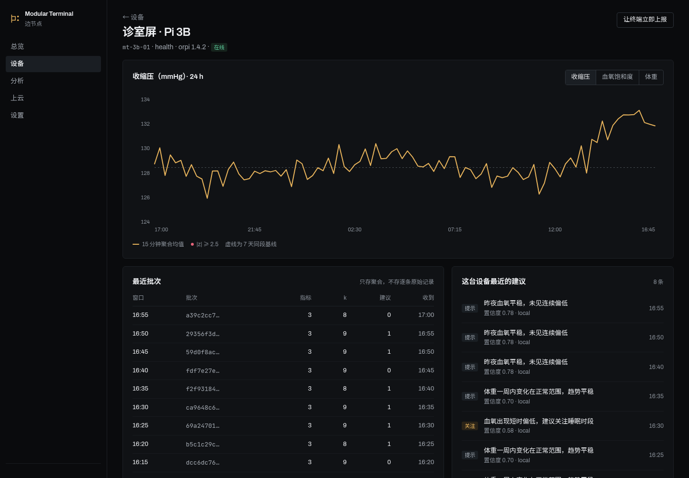
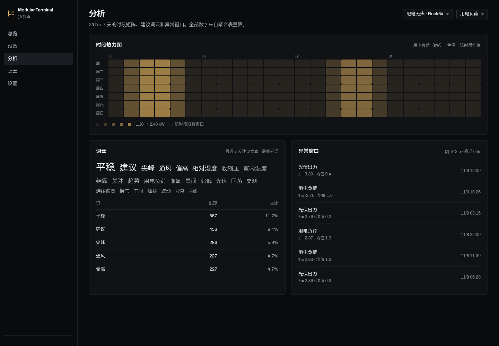

# Modular Terminal Edge

端-边-云三层里的**边**：局域网内的一台管理节点。三台 Pi 终端把 5 分钟窗口的
**假名聚合**推上来，这里做趋势、时段矩阵、词云和异常检测，再把日聚合打包上报云端。


## 每个页面回答一个问题

| 页面 | 它回答的问题 | 关键内容 |
|---|---|---|
| 总览 | 三台终端此刻都在报数吗？ | 24 个窗口的到达条、最小 k、24 h 最值得说的三件事、建议流 |
| 设备 | 哪台设备在偏离基线？ | 设备表 + 下钻趋势（15 分钟聚合）、批次表、该设备的建议 |
| 分析 | 什么时段在出事？ | 7×24 时段矩阵、建议词云 + 词频 Top 5、\|z\| ≥ 2.5 的异常窗口 |
| 上云 | 云端拿到的是什么？ | 发件箱、报表结构、这份报表会发的前 8 行日聚合 |
| 设置 | 上报节奏、云连接、隐私开关 | 改动即生效，没有"保存"按钮 |




## 快速开始

需要 Python 3.10+（只用到标准库 + FastAPI 一套），**不需要 Node、不需要构建**。

```bash
python3 -m pip install -r requirements.txt
./run.sh                       # 首次会自动写入 7 天演示数据
# http://127.0.0.1:8001
```

Docker：

```bash
cd docker && docker compose up -d --build
```

配置全部走环境变量，见 [`.env.example`](.env.example)。

## 数据流

```
终端 10 个隔离用户库
      │  每个 5 min 窗口：n / mean / slope / z / k
      │  k < 5 的桶在端内丢弃，只上报「抑制了几个」
      ▼
POST /api/v1/ingest/telemetry   ← 出现 user_id / subject / values 直接 422
      │
      ├─ telemetry   原样存档（只为审计，不参与聚合）
      ├─ aggregates  5 min 聚合，前端与报表都从这张表重算
      └─ advice      建议文本 → 词频 → 词云
      ▼
POST /api/v1/report/cloud      日聚合 + 建议 + 词频 + 隐私计数
      │  失败进发件箱，按 report_id 幂等
      ▼
云
```

幂等键是 `sha256(device_id + window.from + window.to)[:16]`，重复投递只回 `duplicate`，不再写库。

## 隐私边界

| 允许进边 | 一律拒收 |
|---|---|
| `mean`、`slope`、`z`、`n_subjects`、`n_samples`、`k` | `user_id`、`user_name`、`subject` |
| 建议文本（不含姓名与地名） | `values`、`samples`、`raw_samples`、`records` |
| 抑制计数 | `privacy.raw = true` |

拒收是整份 422，不做"过滤后放行"——静默清洗会掩盖上游的 bug。
计数在 `/api/v1/privacy` 与设置页的自检里可查。

## API

完整定义见 [`contracts/openapi/edge.yaml`](contracts/openapi/edge.yaml)，
运行时的 Swagger 在 `/api/docs`。

设备侧只有一条写路径（`/ingest/telemetry`）；管理侧读多写少。
设了 `EDGE_INGEST_TOKEN` / `EDGE_ADMIN_TOKEN` 才校验 `Authorization: Bearer`，
默认空表示只接受本机访问——多机部署必须设。

## 契约

| 契约 | 位置 | 谁拥有 |
|---|---|---|
| `orpi.telemetry.v1`（端→边） | `contracts/wire/telemetry.v1.json` | 端仓，本仓 vendor 到 `contracts/vendor/terminal/` |
| `orpi.edge.report.v1`（边→云） | `contracts/wire/edge-report.v1.json` | **本仓**，云 vendor 走 |

`python3 scripts/sync_contracts.py --check` 校验 vendor 副本没漂移。

## 测试

```bash
python3 -m unittest discover -s tests -t . -v
```

14 个用例：契约示例必须通过模型校验、原始字段必须被拒、k<5 必须被抑制、
重复投递必须幂等、热力图不得重复成格、报表样本数必须等于日聚合之和。

## 与方案 v2.2 的差异

已经实现的写在上面；**还没做的**在这里，避免误以为都通了：

| 方案里的东西 | 现状 |
|---|---|
| MQTT 8883 + mTLS 主题接入 | 未实现，改用 HTTPS `ingest/telemetry`（幂等与载荷完全一致，换接入层不影响其他部分） |
| 边 CA / 配对码签发证书 | 只实现了配对码生成与展示，证书签发与 CRL 未做 |
| mDNS 真实广播发现 | `/discovery` 返回静态清单，字段与 `_orpi-device._tcp` 的 TXT 对齐 |
| 定时上云（每小时） | 只实现手动触发；进程内定时器未做，需要时加 APScheduler 或在系统 cron 里打 `/report/cloud` |
| SQLite 磁盘加密（LUKS/SQLCipher） | 未做，部署时请把 `data/` 放在加密卷上 |

演示数据由 `edge/seed.py` 生成（3 台设备 × 10 个用户 × 7 天 × 5 分钟），
**不是真实测量**；接真机前请清掉 `data/edge.db`。

## 目录

```
edge/          API、存储、分析、演示数据、前端静态资源
contracts/     wire 契约、示例、OpenAPI、vendor 副本
tests/         契约 / 摄取 / 分析三组用例
docker/        compose 与 Dockerfile 说明
scripts/       vendor 契约同步
docs/          截图
```
