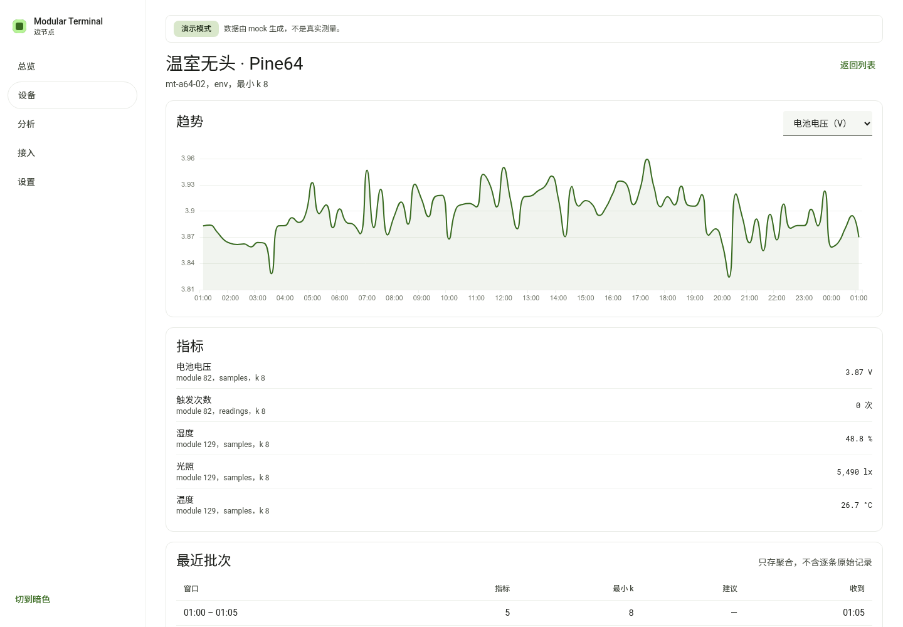
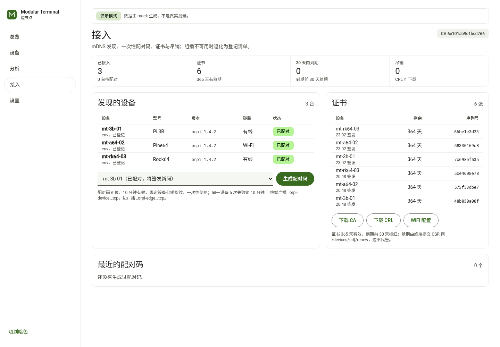
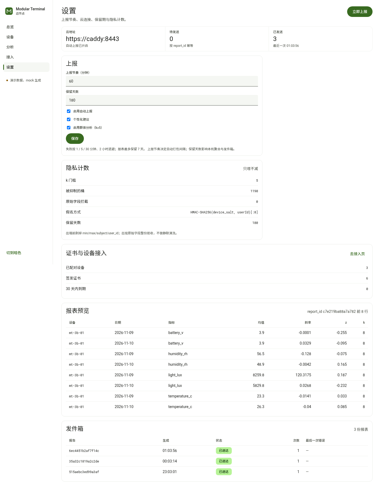

# Modular Terminal Edge

端-边-云三层里的**边**：局域网内的一台管理节点。三台 Pi 终端把 5 分钟窗口的
**假名聚合**推上来，这里做趋势、时段矩阵、词云和异常检测，再把日聚合打包上报云端。

## 界面（1900×1040，亮色）

| 总览 | 设备 | 设备详情 |
|---|---|---|
|  |  |  |
| **分析** | **接入** | **设置** |
|  |  |  |

截图是按 1900×1040 截的；页面用 `clamp` 栅格，1920/1440/1366 下总览也是整屏不滚动。

## 边、云两仓的分工

| | 边（本仓） | 云（另一仓） |
|---|---|---|
| 位置 | 局域网内一台管理节点 | 内网私有云 |
| 面向对象 | 3 台终端（1 台带屏 + 2 台无头） | 多个边节点，每个边下面若干台设备 |
| 数据粒度 | 5 分钟窗口的假名聚合 | 日聚合，没有逐条记录 |
| 身份 | 设备证书 + 配对码，MQTT 走 mTLS | 管理员口令 + TOTP，会话是签名 cookie |
| 存储 | SQLite，设 `EDGE_DB_KEY` 走 SQLCipher | Postgres 16 + Redis 7 |
| 队列 | 无队列，发件箱表 + 退避重试 | RQ 跑三类文档任务；清理、备份、恢复演练由 worker 的排期线程触发 |
| 分析 | 趋势、7×24 时段矩阵、词云、窗口级 z 异常 | 跨边对比、AI 解读、隐私审计 |
| 告警 | 5 分钟窗口；15 分钟没有批次算数据过期 | 日聚合；2 小时没有上报算边掉线 |
| 入口 | 8001，默认只绑 127.0.0.1 | 443 管理台、8443 mTLS 收报、8088 本机明文 |
| 备份 | 每天一份 SQLite 快照，留 7 份 | 每天 `pg_dump` 留 14 天，周日加密副本，每月恢复演练 |
| 保留期 | 聚合 180 天、文本 365 天 | 日聚合 730 天、文本 365 天 |
| 架构文档 | §5 边缘节点 | §6 云端 |

两边共用一份 `orpi.edge.report.v1` 契约：**边仓拥有它**，云仓 vendor 一份副本，
`scripts/sync_contracts.py --check` 两边都跑。改字段的顺序是先改边仓、再同步云仓，
反过来会漂移。

架构文档 v2.3 里 §5 写边、§6 写云，所以两个仓的「逐条对照」表条目不同，
写法一样：一条对应一个编号，写清要求、现状和怎么验。两边都如实标出没做的部分，
不把「驱动已内置但默认没开」写成「已支持」。

## 与终端仓对齐

指标名、模块号、数据表都取自终端仓的真实实现，不是另起一套：

| 终端里的东西 | 边这里怎么用 |
|---|---|
| `module_id 83` `health.pressure` | 收缩压 / 舒张压 / 脉搏（`measurements` 表） |
| `module_id 80` `planter.environment` | 温度 / 湿度（`samples` 表） |
| `module_id 129` `test.environment` | 温度 / 湿度 / 光照（无头机 A） |
| `module_id 130` `test.counter` | 计数增量 / 计数速率（无头机 B，`readings` 表） |
| 字段白名单 `temperature_c` `humidity_rh` `light_lux` `battery_v` `battery_pct` | 直接作为指标 key |
| `Measurements.systolic/diastolic/pulse` | 直接作为指标 key |

三机布局与方案一致：1 台带屏 + 2 台无头。

**模块不是写死的。** 端在 `telemetry` 里带上 `module_id / label / unit / table / decimals`，
边把它登记进 `catalog` 表（键是 `(device, metric)`）；`status` 主题还可以直接推模块清单。
换一块板子、插一个新模块、同一台机器换模块，边都不用改代码：

- 新指标第一次出现就出现在 `/api/v1/metrics` 与所有下拉框里
- 设备的模块列表来自 `status`，不再有 `DEVICES` 常量
- 演示数据每次 `./run.sh` 都会重抽板子与模块组合（`edge/sim.py` 的 `fleet()`）

`catalog` 表就是「这台设备有哪些指标」的唯一事实来源，分析层、热力图、
上云报表全部从它取标签和单位。


## 每个页面回答一个问题

前端是 Vue 3 + Vite + ECharts，样式用自写的 Material 3 token（颜色角色、字阶、形状、
状态层、密度都按 m3.material.io 的定义，不引组件库）。亮色默认，侧栏左下角可切暗色；
ECharts 图表与数据流缩略图都会跟着换主题；紧凑密度（行高 40px）为了在一屏里多看 30% 的数据。

| 页面 | 它回答的问题 | 关键内容 |
|---|---|---|
| 总览 | 现在有没有事，先处理哪一条？ | 状态行（严重度 + 计数）、待处理异常 Top 4（确认/静音）、链路到达条、近 24 小时对比、数据流缩略图 |
| 设备 | 哪台设备在偏离基线？ | 设备表、模块清单、最近批次；点进去是趋势（ECharts）+ 指标 + 批次 |
| 分析 | 什么时段在出事？ | 7×24 时段矩阵（按基线偏差 z 着色）、按设备分行的异常时间轴、建议用词 |
| 接入 | 谁连上来了，证书还有多久？ | mDNS 发现、链路类型、配对码、证书剩余天数、CA/CRL 下载 |
| 设置 | 上报与环境怎么配？ | 上报节奏、保留期、云连接与发件箱、隐私计数、报表预览（上云已并入本页） |

## 快速开始

```bash
python3 -m pip install -r requirements.txt
./run.sh                       # 首次自动写入 7 天演示数据
# http://127.0.0.1:8001
```

前端（Vue 3 + Vite + ECharts，手写 Material 3 token）：

```bash
cd web && npm install && npm run dev     # http://127.0.0.1:5173，/api 代理到 8001
npm run build                            # 产物 dist/ 不进仓库，镜像里多阶段构建
```

Docker（含 mTLS broker）：

```bash
python3 scripts/make_broker_cert.py mqtt.edge.local   # 用边 CA 签 broker 证书
cd docker && docker compose up -d --build
./scripts/verify_acl.sh                               # 实测设备只能读写自己的前缀
```

`make_broker_cert.py` 用的是**宿主 `data/ca`**，容器里的边用 `edge_data` 卷。两边必须是同一套 CA，
否则新签的设备证书会被 broker 以 `bad certificate` 拒掉。改过数据卷之后先对齐：

```bash
docker cp mt-edge-api:/app/data/ca/. data/ca/ && python3 scripts/make_broker_cert.py mqtt.edge.local
docker restart mt-mqtt
```

`verify_acl.sh` 会先查这一步，不一致就直接报错。

配置见 [`.env.example`](.env.example)。

## 数据流

```
终端 10 个隔离用户库
      │  每个 5 min 窗口：n / mean / slope / z / k
      │  k < 5 的桶在端内丢弃，只上报「抑制了几个」
      ▼
MQTT over TLS1.3 + mTLS        orpi/v1/{deviceId}/telemetry     ← 主通道
HTTPS  POST /ingest/telemetry                                   ← 兜底通道
      │  两条路都进 ingest.process：同一份校验、同一份幂等
      ├─ telemetry   原样存档（只用于审计）
      ├─ aggregates  5 min 聚合，前端与报表都从这张表重算
      ├─ advice      建议文本 → jieba 分词 → 词频
      └─ alert_state 人工动作（确认/静音），告警本身由 aggregates 现算
      ▼
每小时打包 orpi.edge.report.v1 → 云端
      失败进发件箱，按 1 min / 5 min / 30 min / 2 h 退避，最多 7 天
```

幂等键 `sha256(device_id + window.from + window.to)[:16]`，重复投递只回 `duplicate`。

## 已实现的功能

| 能力 | 说明 | 验证方式 |
|---|---|---|
| MQTT + mTLS 接入 | QoS1、`telemetry/advice/status/ack/cmd` 五个主题、retained status、ACK 回执；status 里的版本/模块/队列深度都会落库 | `tests/test_mqtt.py` 跑假 broker；compose 里真 mosquitto 做过 mTLS 握手（TLSv1.3，身份 edge-lab-01） |
| 边 CA / 设备证书 | CN=deviceId、OU=mt-device、365 天、ECDSA P-256 | `tests/test_security.py` |
| 配对码 | 6 位 / 10 分钟 / 一次性 / 绑定公钥指纹 / 5 次失败锁 10 分钟 | 同上 |
| 吊销与 CRL | 吊销后 `verify()` 失败，CRL 可下载 | 同上 |
| mDNS | 广播 `_orpi-edge._tcp`、发现 `_orpi-device._tcp` 与 `_orpi-cloud._tcp`；静态地址（环境变量或 `cloud.json`）兜底 | `edge/mdns.py`；容器内实测发现到 `https://172.20.0.5:8443`，组播不可用时退化 |
| 定时上云 | 每小时生成报表 + 到期队列投递 | `tests/test_scheduler.py` |
| 退避与保留期 | 1/5/30 分钟、2 小时，7 天发不出去就丢弃；L2 聚合保留 180 天、L3 文本 365 天 | 同上 |
| 隐私闸门 | 批次与每一行的 k<5 都拦、原始字段整份 422、min/max/subject 不出端 | `tests/test_contracts.py` |
| 写入口防护 | 每 IP 120 次/分；磁盘余量低于 512 MB 回 507；MQTT 同样按水位拒收 | 同上 |
| 证书校验 | 出站前用同一份契约再验一次 | `cloudpush.send` |
| 指标目录 | 端报什么就登记什么，前端下拉框动态生成 | `edge/catalog.py` + `/api/v1/metrics` |
| 磁盘加密 | 新装自动生成 `data/edge.key` 并走 SQLCipher；已有明文库不自动迁移，启动时标 `db_plaintext_existing`，迁移用 `scripts/encrypt_db.py`；迁移后重启复用同一把 key | `store._ensure_key` |
| 每日快照 | 每天一份 SQLite 快照，保留最近 7 份；加密库用 `VACUUM INTO` 生成同样加密的副本 | `store.snapshot` + `tests/test_scheduler.py` |
| 演示模式 | 演示环境显式开启群体分析并写审计（时间/操作者/构建号）；侧栏底部标注「演示数据」 | `edge/sim.py`、`/api/v1/health` 的 `demo` |
| 告警状态机 | 连续越界窗口合并成一条；确认、静音、取消静音都写审计 | `tests/test_alerts.py` |
| 词频 TF-IDF | jieba 分词 + 停用词，按天重算，查询时用 TF-IDF 加权（跨天高频词降权） | `/api/v1/wordcloud`，页面点词下钻到建议原文 |
| WiFi 配置生成 | 管理员给无头终端生成 `wpa_supplicant.conf`；口令只在请求里出现，不落库、审计只记长度 | `POST /api/v1/devices/{id}/wifi-config` |

### 最近补的

- **MAD 异常口径**：每个窗口拿过去 24 h 的 mean 算 median/MAD，稳健 z = 0.6745·(x−med)/MAD，阈值 3.5、连续 2 窗口；样本 <5 或 MAD=0 时回退基线 z（阈值 2.5）。页面仍显示基线 z，异常点额外带 `robust_z`。
- **新装默认加密**：`EDGE_AUTO_ENCRYPT=1` 时自动生成 `data/edge.key`（0600）并走 SQLCipher；老明文库不自动迁移，`/health` 标 `db_plaintext_existing`，跑 `scripts/encrypt_db.py` 会先备份再校验行数；迁移后 key 与库同卷，重启直接复用；加密库的每日快照改用 `VACUUM INTO`。
- **吊销 5 s 内断连**：`scripts/install_crl_reload.sh` 装 systemd user timer，`crl.pem` 内容一变就 `docker kill -s HUP mt-mqtt`，不用挂 docker socket。
- **同意开关不再把报表卡死**：关掉个性化后 `privacy.personalization=false` 是契约里的可选字段，自己那层严格校验不会再把它拦下来；行级 `k<5` 也在边就拦掉，不会存下来再让云端整份 422；发件箱按文档 §5.8 只重试 7 天，过期记 `outbox_expired` 后丢弃。
- **写入口默认要令牌**：首次启动生成 `data/ingest_token`（0600），HTTP `POST /ingest/*` 无令牌直接 401；`/health` 里 `ingest_token` 显示 `set`。
- **吊销即时生效**：`/devices/{id}/revoke` 重写 `certs/crl.pem`，mosquitto 的 `crlfile` 读它；消息层再按 `device_id` 拒收，不用等 broker 重载。
- **下发命令真的走 MQTT**：`POST /devices/{id}/cmd` 发布到 `orpi/v1/{id}/cmd` 并写 `device.cmd` 审计；演示环境同时本地补一个窗口。
- **总览重做**：首屏 6 块图（链路矩阵、每设备 24h 走势、7×24 异常、建议风险、24h 对比、指标覆盖），弹性栅格在 1900 / 1440 / 1366 下都整屏无滚动。
- **逐设备 ACL 真的测过**：`scripts/verify_acl.sh` 用边 CA 现签一张临时证书连 8883，实测「自己的 telemetry 能发、自己的 cmd 能收、别人的遥测与通配订阅被拒」，跑完删证书与库里的签发记录：
  ```
  [PASS] 自己的遥测能发     [PASS] 自己的 cmd 能收（边可下发）
  [PASS] 别人的遥测被拒     [PASS] 读不到别人的遥测
  [PASS] 通配订阅读不到东西
  ```
- **同意开关真的生效**（文档 §8.5）：关掉 `group_analysis` 后，总览只回在线/健康/匿名计数，设备详情、趋势、热力、异常、建议、批次、词云全部返回空并标 `insufficient`，上云报表也只带设备在线状态；关掉 `personalization` 后报表里的 `advice` 与 `word_freq` 清空，建议只留本地。开关变更写 `consent.change` 审计（改动前后、操作者）。
- **假云进不来**：mDNS 只解决地址，不解决信任。边发现 `_orpi-cloud._tcp` 时拿 TXT 里的 `ca_fp` 和预置的
  `cloud-ca.crt` 比（同一口径：证书 DER 的 SHA256 前 16 hex），对不上就不换上报地址，写 `mdns.cloud_rejected`
  审计；`/api/v1/discovery` 的 `edge.cloud` 里能看到 `pinned_fp`、当前用的是静态还是 mDNS、最近被拒的原因。
  没预置 CA 时无法比对，仍放行 —— 此时靠 mTLS 兜底。
- **吊销写 CRL 的坑补了**：api 容器以 uid 10001 跑，证书目录原来对它只读，`crl.pem` 一直没被重写（错误被吞掉）。现在 `make_broker_cert.py` 把目录设 0777、`crl.pem` 设 0666，写失败会记 `cert.crl_write_failed` 审计。

## 告警怎么判定、怎么关掉

一条告警不是「一个窗口越界」，而是**一段连续的越界窗口**：一段只算一条。
不合并的话，一次持续 20 分钟的漂移会刷出四条，列表就没法看了。

| 级别 | 判定 |
|---|---|
| 严重 | 段内有两个相隔不超过 2 个窗口的 `\|z\| ≥ 2.5`；或 15 分钟没有新批次 |
| 注意 | 单窗口 `\|z\| ≥ 2`，但没到严重的程度 |

人工只有两个动作，恢复是自动的：

| 状态 | 怎么进来 | 效果 |
|---|---|---|
| 待处理 | 新的一段越界窗口 | 进首屏「待处理」，按严重度排序 |
| 已确认 | 点「确认」 | 留在列表里，视觉降级，不再计入首屏结论 |
| 已静音 | 点「静音」，选 1h / 8h / 24h / 7d 并填理由 | 条目变灰，显示理由与到期时间，可取消静音 |
| 已恢复 | 后续窗口回到 `\|z\| < 2` | 读取时自动推出，不需要人工关 |

确认、静音、取消静音都写 `audit`：谁、什么时候、对哪一条、理由是什么。
静音不带理由会被 422 挡掉——审计里写不出「为什么」的静音等于没写。

## 隐私边界

| 允许进边 | 一律拒收 |
|---|---|
| `mean`、`slope`、`z`、`n_subjects`、`n_samples`、`k` | `user_id`、`user_name`、`subject` |
| 建议文本（不含姓名与地名） | `values`、`samples`、`raw_samples`、`records` |
| 抑制计数 | `privacy.raw = true` |

拒收是整份 422，不做"过滤后放行"；计数在 `/api/v1/privacy` 与设置页自检里可查。

## API

完整定义见 [`contracts/openapi/edge.yaml`](contracts/openapi/edge.yaml)，运行时 Swagger 在 `/api/docs`。

接入与告警相关的新增端点：

| 方法 | 路径 | 用途 |
|---|---|---|
| POST | `/api/v1/pair/redeem` | 终端拿配对码 + CSR 换 365 天证书 |
| GET | `/api/v1/metrics` | 端上报过的全部指标（动态，无写死列表） |
| GET | `/api/v1/ca.crt` | 下发给终端的 CA |
| GET | `/api/v1/crl.pem` | 吊销列表 |
| GET | `/api/v1/certs` | 已签发证书 |
| POST | `/api/v1/devices/{id}/revoke` | 吊销某台设备的全部证书 |
| POST | `/api/v1/devices/{id}/renew` | 设备带 CSR 换新证书（旧证书到期自然失效） |
| POST | `/api/v1/devices/{id}/wifi-config` | 给无头终端生成 `wpa_supplicant.conf` |
| POST | `/api/v1/certs/verify` | 校验一张证书 |
| GET | `/api/v1/alerts` | 待处理 / 已确认 / 已静音的告警（一段越界窗口一条） |
| POST | `/api/v1/alerts/ack` | 确认一条告警 |
| POST | `/api/v1/alerts/mute` | 静音一条，必填时长与理由 |
| POST | `/api/v1/alerts/unmute` | 取消静音 |

## 契约

| 契约 | 位置 | 谁拥有 |
|---|---|---|
| `orpi.telemetry.v1`（端→边） | `contracts/wire/telemetry.v1.json` | 端仓，本仓 vendor |
| `orpi.advice.v1`（端→边） | `contracts/wire/advice.v1.json` | 端仓；端仓未发布前由本仓代为维护 |
| `orpi.status.v1`（端→边） | `contracts/wire/status.v1.json` | 端仓；本仓 vendor |
| `orpi.cmd.v1`（边→端） | `contracts/wire/cmd.v1.json` | **本仓** |
| `orpi.edge.report.v1`（边→云） | `contracts/wire/edge-report.v1.json` | **本仓** |

`python3 scripts/sync_contracts.py --check` 校验 vendor 副本没漂移。

## 测试

```bash
python3 -m unittest discover -s tests -t . -v
```

**61 个用例**：契约与示例（含 advice / status / cmd）、摄取边界（原始字段 / 批次与行级 k<5 / 幂等 / 限速 / 磁盘水位）、分析口径
（热力图不重复、报表样本数等于日聚合之和）、CA 与配对与 CRL、
MQTT 真实报文往返、mDNS 只收 CA 指纹对得上的云、退避序列、发件箱 7 天过期、保留期清理、每日快照、
SQLCipher 加密与错误口令拒绝、异常需连续窗口、告警合并与确认/静音/审计。

## 与架构文档 v2.3 的逐条对照

| 文档条目 | 要求 | 现状 |
|---|---|---|
| §5.1 部署形态 | Compose 四服务、每日快照 | ✅ 四个服务齐全；8884 管理口只绑宿主 loopback、仍走 mTLS；每日快照保留 7 份（`data/snapshots/`），路径可用 `EDGE_DATA_DIR` 指到 `/srv/...` |
| §5.2 接入与主题 | 5 个主题、QoS1、retained status、幂等 | ✅ 全部实现，ACK 回执带 batch_id |
| §5.3 存储 | devices/telemetry/aggregates/advice/word_freq | ✅ 另加 catalog、certs、revoked、audit、outbox、alert_state |
| §5.4 分析 | 趋势 / 热力 / 词云 / 异常 | ✅ 四项都在页面上，数字全部重算；异常用 7 天同时段基线 z + 连续 2 窗口，未上 MAD |
| §5.5 API | 10 个端点 | ✅ 全部实现，另有 metrics/certs/pair/renew 与告警四个端点 |
| §5.6 前端 | Vue3 + Vite + ECharts，五页 | ✅ 五页齐全；总览首屏 6 块图（链路矩阵、每设备 24h 走势、7×24 异常、建议风险、24h 对比、指标覆盖）+ 右栏待处理与建议；接入/设置各 2 块图；分析页热力图按基线偏差着色 |
| §5.7 设备接入 | CA、配对码、365 天证书、吊销、续期 | ✅ CA/配对/365 天证书/吊销完成；吊销后重写 `certs/crl.pem`，消息层立即拒收，宿主 systemd timer 5 s 内让 broker 重读 CRL；续期是**设备主动 renew + 30 天提醒**，边不代签 |
| §5.8 边→云 | 每小时批量、幂等、退避 | ✅ 1/5/30 分钟、2 小时退避，7 天 |
| §5.9 mDNS | 广播 + 发现，TXT 只放 ID/型号/版本/端口/CA 指纹 | ✅ 云地址优先用 mDNS 发现的，静态地址兜底；只靠 mDNS 也能触发定时上云；发现云时比对 `ca_fp`，对不上就当假云丢弃（§8.4） |
| §8.4 写入口防护 | 限速 + 单条/单批上限 + 磁盘水位 | ✅ 单批上限在 schema 里；每 IP 120 次/分；磁盘余量低于 512 MB 时 HTTP 回 507、MQTT 直接拒收 |
| §5.10 无头与十用户 | 1 带屏 + 2 无头，10 用户轮换 | 部分：演示数据里有 1 带屏 + 2 无头；端仓还没有 headless 构建，也没有 10 用户轮换 |

## 仍然没做的

| 方案里的东西 | 现状 |
|---|---|
| 老库迁移 | 新装默认加密；升级前就是明文的库不自动迁移（避免启动时重写），跑 `scripts/encrypt_db.py`，会先备份成 `.plain-*.bak` 并校验行数 |
| 性能基线 | 本机 `/overview` p95 338 ms、`pg_dump` 0.3 s；目标机 CPU 与 72 h 未测 |
| 证书自动续期 | 刻意不做边代签：续期由终端提交 CSR 调 `/devices/{id}/renew`，边只负责 30 天提醒 |
| 多边组网 | 单边单云，不支持一个边管多个云 |
| 宿主 Avahi / chrony | 已加 `scripts/verify_host.sh`；本机 avahi-daemon + chrony 都 active，目标机还没跑过 |


演示数据由 `edge/sim.py` 生成（3 台设备 × 7 天 × 5 分钟窗口，`n_subjects` 取 6–10），
**不是真实测量**；接真机前请清掉 `data/`。

端侧（另一仓）还缺的，本仓只标注、不代做：

- §3 data_schema 与 DB API v3：`ModuleDataApi` 仍然只有 `appendSample`，数据字段
  在代码里硬编码，没有 `module_records` 表，`module-devkit` 也没有 schema 子命令；
- §4 HyperVisor：没有过滤层（HMAC 假名、5 分钟窗口、k≥5）、没有 `agg` / `outbox`、
  没有 `appAdvice`、没有 `advice` 出网通道 34007；
- §5.10 headless 与 10 用户轮换：没有 headless 构建目标，也没有 `--user-rotate`；
- §8 的 `device_salt`、L1-out 默认出端、per-subject 删除 token。

所以本仓的 `/ingest` 与 `telemetry.v1` 已经能收，但现在只有 `edge/sim.py` 在发。

## 本机还能补的，和只能等硬件的

| 项 | 本机能否完成 | 现状 |
|---|---|---|
| 逐设备 MQTT ACL | ✅ 已完成 | `scripts/verify_acl.sh`：边 CA 现签证书连 8883，自己前缀能发能收，别人前缀与通配订阅被拒 |
| 性能基线（§11.2 / §11.3） | 能，已测一轮 | 边 `/overview` p95 338 ms、云 `/overview` p95 200 ms、`pg_dump` 0.3 s、各容器内存均低于限额；CPU/72 h 需在目标机复测 |
| 同意开关落地 | ✅ 已完成 | 关 `group_analysis` → 总览「样本不足」、词云空；关 `personalization` → 报表不带 advice/词频；变更写审计 |
| mDNS 假云拦截 | ✅ 已完成 | 云广播的 `ca_fp` 与预置 `cloud-ca` 比对，不符就丢弃并写 `mdns.cloud_rejected` 审计（`tests/test_mdns.py`） |
| 本地 9B 模型 | 不能 | 无 NVIDIA 显卡，模型 5.6 GB，等 GPU |
| 双网 30 s / 10 用户轮换 / 72 h | 不能 | 需要三台终端 |
| 端侧 §3 / §4 | 不在本仓 | 已分发给端仓 |
| 备份异地 | 不能 | 需要第二块盘 |

## 目录

```
edge/          API、摄取、分析、CA、MQTT、mDNS、调度
web/           Vue 3 + Vite 前端：M3 token、ECharts、数据流缩略图
contracts/     wire 契约、示例、OpenAPI、vendor 副本
tests/         契约 / 摄取 / 分析 / 安全 / MQTT / 调度 / 告警
docker/        compose、mosquitto（TLS + ACL）
scripts/       vendor 契约同步、broker 证书、CRL 重载、明文库迁移
docs/          截图
data/          运行期数据（演示库、快照），不进仓库
```
